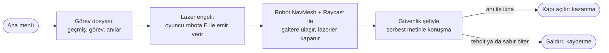

# The Ark

Yazılım Geliştirme Laboratuvarı-I, Proje 1 · Kocaeli Üniversitesi Teknoloji Fakültesi, Bilişim Sistemleri Mühendisliği

| Ekip üyesi | Öğrenci no | Sorumluluk |
|---|---|---|
| ⟨Ad Soyad⟩ | ⟨No⟩ | Otonom companion (NavMesh, Raycast, durum makinesi), sahne, menü |
| ⟨Ad Soyad⟩ | ⟨No⟩ | Yerel LLM NPC (Ollama), hata yönetimi, bitiş ekranı, testler |

Tarih: 6 Kasım 2026

> Taslak: birleştirmeden sonra deponun kök dizinine `README.md` olarak taşınır. ⟨…⟩ işaretli yerler doldurulacak.

## İçindekiler

1. [Giriş](#1-giriş)
2. [Otonom Companion](#2-otonom-companion)
3. [LLM Destekli NPC](#3-llm-destekli-npc)
4. [Hata Yönetimi](#4-hata-yönetimi)
5. [Testler ve Ekran Görüntüleri](#5-testler-ve-ekran-görüntüleri)
6. [Sonuç ve Tartışma](#6-sonuç-ve-tartışma)
7. [Kurulum ve Çalıştırma](#7-kurulum-ve-çalıştırma)
8. [Kaynaklar ve Lisanslar](#8-kaynaklar-ve-lisanslar)

## 1. Giriş

**Problem ve amaç.** Oyunlarda yapay zekâ çoğunlukla önceden yazılmış davranışlarla taklit edilir. Bu projede tek bir Unity oyununda iki gerçek ve birbirinden bağımsız yapay zekâ bileşeni bir araya getirildi: NavMesh ile kendi yolunu bulan otonom bir robot ve bilgisayarda yerel çalışan bir dil modeliyle konuşan bir NPC. Dil modelinin serbest metninden oyun durumunu değiştiren kararın güvenilir biçimde ayrıştırılması, sunucu kapalıyken bile oyunun çökmemesi ve beklerken oyunun donmaması temel hedeflerdir.

**Hikâye.** Oyuncu, iki yıl önce bir kazada öldüğü sanılan ve The Ark şirketi tarafından yarı makine olarak yeniden inşa edilen bir adamdır. Karısı tesisin güvenlik şefidir; zihni yıkanmıştır ve onu tanımaz. Oyuncunun amacı kontrol merkezine ulaşmaktır.

**Oyun akışı.**

## 2. Otonom Companion

⟨A: robotun algılama (Raycast) ve yol bulma (NavMesh) açıklaması, durum makinesi sınıfları⟩

**Davranış modları.** Mimari, durum tabanlı karma bir yol bulma ve keşif sistemidir (State-Based Hybrid Navigation and Exploration System).

1. **Takip (varsayılan).** Robot oyuncuyu izler. Oyuncu E tuşuyla görev verince ilgili moda geçer.
2. **Keşif: NavMesh düğümleri.** Robot daha önce bilmediği orb'ları tarar. Engel ile şalter arasındaki ilişkiyi kurduğu objeyi bulunca keşfi keser, şaltere gider ve engeli açar; görev bitince Takip'e döner.
3. **Labirent: ızgara tabanlı keşif.** Robot önce labirent girişine gider. Labirent alanına girince NavMesh keşfini kapatır ve `MazeRaycastNavigator` ile ızgara algoritmasına geçer. Son şaltere 1,5 m yaklaşınca şalteri kapatır, labirent modundan çıkar ve NavMesh keşfini yeniden başlatır.

| Özellik | NavMesh düğüm algoritması | Labirent ızgara algoritması |
|---|---|---|
| Kullanıldığı yer | Normal oyun alanı | Labirent alanı |
| Keşif birimi | NavMesh düğümleri | Izgara hücreleri |
| Amaç | Orb keşfi, hedef bulma | Labirenti çözme |
| Başlama koşulu | Keşif modu | Labirent alanına giriş |
| Bitiş koşulu | Şalter görevinin tamamlanması | Son şaltere 1,5 m yaklaşma |
| Sonraki durum | Takip | Takip + NavMesh keşfine dönüş |

Karar akışı: `docs/rapor/companion-akis.md` buraya taşınır.

## 3. LLM Destekli NPC

`docs/rapor/llm-npc.md` bölüm 3 buraya taşınır (mimari, model seçimi, sınıf ve sequence diyagramları, şema, tam system prompt, durum diyagramı, injection savunması).

## 4. Hata Yönetimi

`docs/rapor/llm-npc.md` bölüm 4 buraya taşınır.

## 5. Testler ve Ekran Görüntüleri

### 5.1 Otonom companion

Robot, farklı başlangıç konumlarından labirentteki şaltere gönderildi.

| Test | Başlangıç (X, Y, Z) | Süre | Sonuç | Yeniden rota | Gözlem |
|---|---|---|---|---|---|
| T1 | (2.786, 0.1773, 2.906) | 7,68 sn | Başarılı | 1 | Sorun yok |
| T2 | (0.779, 0.1773, 2.906) | 8,33 sn | Başarılı | 2 | Takılma yaşandı |
| T3 | (1.743, 0.1773, 2.906) | 4,77 sn | Başarılı | 0 | Sorun yok |
| T4 | (4.736, 0.1773, 2.906) | 15,70 sn | Başarısız | 6 | Lazer çarpışması |
| T5 | (3.831, 0.1773, 2.906) | 8,49 sn | Başarılı | 0 | Sorun yok |
| T6 | (3.262, 0.1773, 2.906) | 8,11 sn | Başarılı | 4 | 4 kez yeniden rota |
| T7 | (2.254, 0.1773, 2.906) | 5,58 sn | Başarılı | 3 | 3 kez yeniden rota |
| T8 | (4.993, 0.1773, 2.906) | 4,99 sn | Başarılı | 0 | Sorun yok |
| T9 | (1.730, 0.1773, 2.906) | 4,30 sn | Başarılı | 0 | Sorun yok |
| T10 | (3.870, 0.1773, 2.906) | 3,40 sn | Başarısız | 6 | Lazer çarpışması |

Başarı oranı **%80** (8/10) · başarılı denemelerin ortalama süresi **6,53 sn** (52,25 / 8) · en hızlı 4,30 sn (T9) · toplam yeniden rota 22.

T4: robot sağdaki başlangıç konumundan labirente girdi, içeride dolaştı ama şalteri bulamadı; başlangıç bölgesine dönüp girişe yönelirken lazere çarptı.
⟨A: "yeniden rota" ve sürenin nasıl ölçüldüğü (bir cümle), ekran görüntüleri⟩

### 5.2 LLM NPC

`docs/rapor/llm-npc.md` bölüm 5 buraya taşınır (9 diyalog senaryosu × 3, injection ölçümü, oyun içi denemeler, ekran görüntüleri).

### 5.3 Otomatik testler

Unity Test Framework, EditMode: 127 test geçiyor; gerçek Ollama gerektiren 4 test ayrıca çalıştırılır ve geçiyor.

## 6. Sonuç ve Tartışma

**Başarılar.**
* İki yapay zekâ bileşeni ayrı derleme birimlerinde, birbirini tanımadan, yalnızca olaylarla haberleşiyor.
* Robot, NavMesh ve Raycast ile engeli kendisi aşıyor; 10 denemenin 8'inde başarılı.
* NPC'nin her sözü yerel modelden geliyor; karar JSON şemasıyla ayrıştırılıyor, 27/27 diyalog turu hatasız, kandırma denemelerinde kapı 0/87 açıldı.
* Ollama kapalı, model yok, zaman aşımı ve bozuk cevap durumlarında oyun çökmüyor; model beklenirken oyun 216 FPS ile akıyor.

**Sınırlılıklar.** ⟨A: companion sınırlılıkları⟩ NPC tarafı: `docs/rapor/llm-npc.md` 5.3.

**Olası geliştirmeler.** ⟨A: companion⟩ NPC tarafı: `docs/rapor/llm-npc.md` 5.3.

## 7. Kurulum ve Çalıştırma

1. [Ollama](https://ollama.com/)'yı kurun ve uygulamayı açın.
2. Terminalde modeli indirin: `ollama pull gemma4:e2b` (yaklaşık 3 GB VRAM kullanır).
3. `Build/` klasöründeki `⟨TheArk⟩.exe` dosyasını çalıştırın.

Ollama açık değilse oyun yine açılır; NPC'ye yazıldığında sarı bir sistem mesajı ne yapılacağını söyler. Model ayarları `⟨TheArk⟩_Data/StreamingAssets/NpcDialogue/ollama_settings.json` dosyasındadır; adres yalnızca `http://127.0.0.1` olabilir.

Kaynaktan açmak için: Unity 6000.3.25f1 (Unity Hub), sahne `⟨Assets/MainMenu.unity⟩`.

## 8. Kaynaklar ve Lisanslar

`docs/rapor/kaynaklar.md` buraya taşınır.
