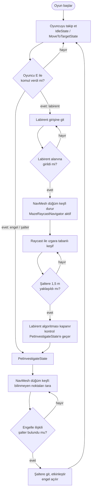

# Companion Karar Akışı

Robotun karar akışı (PDF 5.2). Durum adları koddaki sınıflarla aynıdır: `IdleState`, `MoveToTargetState`, `PetInvestigateState`; labirent keşfi `MazeRaycastNavigator` bileşeniyle yapılır.

