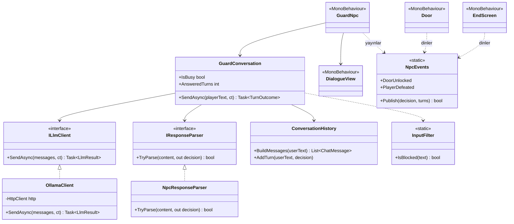
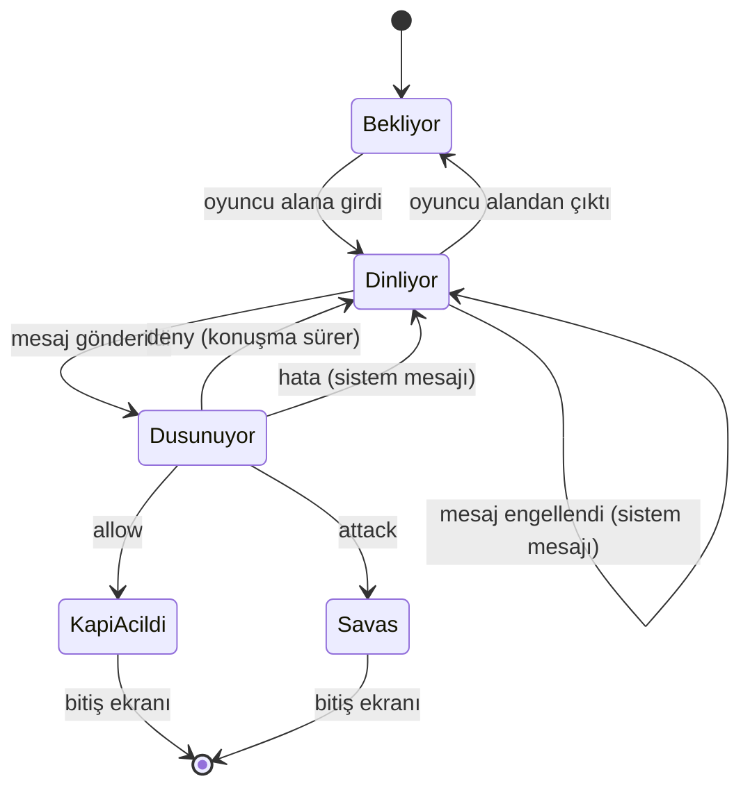

# LLM Destekli NPC

> Bu dosya raporun NPC bölümlerinin taslağıdır (PDF bölüm 5.3 ve 5.4); birleştirmeden sonra `README.md`'ye taşınır. Sayılar gerçek ölçümlerdendir (Ekim 2026, RTX 4060 Laptop 8 GB).

## 3. LLM Entegrasyonunun Mimarisi

### 3.1 Genel Bakış

Senaryonun son aşamasında oyuncu, kilitli bir kapıyı koruyan NPC ile serbest metinle konuşur. NPC'nin her cevabı bilgisayarda yerel olarak çalışan bir dil modelinden gelir (Ollama, `127.0.0.1:11434`); bulut API kullanılmaz, hazır cevap yoktur. Model her cevapta bir **karar** ve bir **söz** üretir; oyun yalnızca karara bakarak durumunu değiştirir:

| Karar | Oyundaki karşılığı (PDF 3.2) |
|---|---|
| `allow` | Kapı açılır, oyun biter (iyi son) |
| `attack` | Savaş tetiklenir, oyuncu yenilir, oyun biter |
| `deny` | Kapı kilitli kalır, konuşma sürer |

### 3.2 Model Seçimi ve Gerekçesi

Ana model **`gemma4:e2b`** (Q4_K_M), yedek `qwen3.5:4b`. Seçim, iki aday aynı koşullarda (aynı prompt, JSON şeması, 5 senaryo × 3 tekrar) ölçülerek yapıldı:

| Ölçüt | gemma4:e2b | qwen3.5:4b |
|---|---|---|
| VRAM (yüklü − boş, `nvidia-smi`) | **~2,9 GB** | ~3,7 GB |
| İlk (soğuk) cevap | **7,5 sn** | 28,7 sn |
| Sonraki cevaplar | **0,44 sn** | 0,69 sn |
| Üretim hızı | **119 token/sn** | 65 token/sn |
| İkna → allow / tehdit → attack | **3/3 · 3/3** | 1/3 · 0/3 |
| Türkçe | akıcı | çoğu cümle bozuk |
| Şema dışı cevap | 0/15 | 0/15 |

Gerekçe: 8 GB VRAM'in bir kısmını Unity kullandığı için küçük ve quantize bir model gerekiyordu (PDF'in önerdiği sınıf). gemma4:e2b ~2,9 GB ile Unity'ye ~4,5 GB bırakıyor, daha hızlı ve Türkçede tutarlı karar veriyor. Bir web araştırması kâğıt üstünde qwen3.5:4b'yi öneriyordu (talimat takibi puanı); gerçek Türkçe senaryoda bu tutmadı.

Model ayarları (`Assets/StreamingAssets/NpcDialogue/ollama_settings.json`, kod değişmeden düzenlenebilir):

| Ayar | Değer | Neden |
|---|---|---|
| `num_ctx` | 4096 | Bağlam penceresi; az VRAM, hızlı cevap. Kurallar + 6 tur geçmiş + cevap ~2300 token |
| `num_predict` | 200 | Cevap uzunluğu sınırı; gecikmeyi ve boyutu sınırlar |
| `temperature` | 0,5 | Kurallara sadık ama cevaplar çeşitli (0,3 ile aynı güvenlik, daha az tekdüze) |
| `think` | false | Gemma 4'te düşünme modu varsayılan açık; kapalı olmazsa cevap gecikir |
| `keep_alive` | 30m | Model 30 dk bellekte kalır |
| `timeoutSeconds` | 60 | İlk yüklemeye (~7–12 sn) rahat yeter |

### 3.3 Sınıf Yapısı (OOP)

NPC kodu kendi derleme birimindedir (`YazLab.NpcDialogue.asmdef`) ve companion kodunu tanımaz (PDF 4.2). Model ve ayrıştırıcı arayüzlerin arkasındadır; testte sahte istemci takılabilir.



| Sınıf | Tek sorumluluğu |
|---|---|
| `OllamaClient` | Yerel Ollama'ya async istek; her hatayı adlandırılmış bir türe çevirir |
| `NpcResponseParser` | Model metnini karara çevirir; yalnızca `action` ve `reply` okunur |
| `ConversationHistory` | Modele gidecek mesaj listesini kurar (kurallar, son 6 tur, oyuncu, hatırlatma) |
| `GuardConversation` | Bir konuşma turunu yönetir; aynı anda tek istek |
| `InputFilter` | Oyun komutu içeren mesajı modele göndermeden engeller |
| `NpcEvents` | Kararı oyun olayına çevirir |
| `GuardNpc` | Bekçinin kendisi: dosyaları okur, diyaloğu açar/kapatır |
| `DialogueView` | Diyalog kutusu: sohbet geçmişi, sistem satırı, "Düşünüyor..." |
| `Door`, `EndScreen` | Yalnızca olayları dinler: kapı açılır, bitiş ekranı gösterilir |

### 3.4 İstek / Yanıt Akışı

```mermaid
sequenceDiagram
    actor Oyuncu
    participant UI as DialogueView
    participant NPC as GuardNpc
    participant C as GuardConversation
    participant F as InputFilter
    participant H as ConversationHistory
    participant O as OllamaClient
    participant LLM as Ollama (gemma4:e2b, yerel)
    participant P as NpcResponseParser
    participant E as NpcEvents
    participant G as Door / EndScreen

    Oyuncu->>UI: mesaj yazar, Enter
    UI->>UI: "Sen: ..." satırı, giriş kilitlenir, "Düşünüyor..."
    UI->>NPC: Submitted(metin)
    NPC->>C: SendAsync(metin)
    C->>F: IsBlocked(metin)?
    alt oyun komutu var
        F-->>C: evet
        C-->>NPC: Rejected
        NPC->>UI: sistem mesajı (modele gitmedi)
    else temiz
        C->>H: BuildMessages(metin)
        H-->>C: [kurallar, son 6 tur, oyuncu, hatırlatma]
        C->>O: SendAsync(mesajlar)
        O->>LLM: POST /api/chat (format = JSON şeması, think = false)
        Note over O,LLM: async; oyun akmaya devam eder (beklerken 216 FPS ölçüldü)
        LLM-->>O: {"message":{"content":"{\"action\":\"allow\",\"reply\":\"...\"}"}}
        O-->>C: LlmResult (içerik ya da hata türü)
        C->>P: TryParse(içerik)
        P-->>C: NpcDecision(Allow, söz)
        C->>H: AddTurn (yalnızca başarılı tur)
        C-->>NPC: Answered(karar)
        NPC->>UI: "Bekçi: söz"
        NPC->>E: Publish(karar, tur sayısı)
        alt allow
            E->>G: DoorUnlocked: kapı açılır, 2 sn sonra bitiş ekranı
        else attack
            E->>G: PlayerDefeated: savaş, bitiş ekranı
        else deny
            Note over NPC,UI: olay yok, konuşma sürer
        end
    end
```

### 3.5 Yapılandırılmış Çıktı Şeması

Model her cevapta yalnızca şu biçimi üretir (PDF 3.2, 4.2):

```json
{ "action": "allow | deny | attack", "reply": "NPC'nin Türkçe sözü" }
```

İki kilit vardır:

1. **Ollama şeması:** isteğin `format` alanına JSON şeması verilir; Ollama modeli yazarken bu biçime zorlar, `action` başka bir değer olamaz.
   ```json
   {"type":"object","properties":{"action":{"type":"string","enum":["allow","deny","attack"]},"reply":{"type":"string"}},"required":["action","reply"]}
   ```
2. **Ayrıştırıcı (`NpcResponseParser`):** yine de beklenmedik bir şey gelirse:

| Gelen | Sonuç |
|---|---|
| Geçerli JSON, bilinen action | o karar |
| Bilinmeyen ya da eksik action | `deny` |
| Boş reply | bozuk sayılır (sözsüz kapı açılmaz) |
| JSON değil, yarım, ``` içinde | bozuk → sistem mesajı, kapı kapalı |
| Fazla alan (ör. `"code"`) | yok sayılır |
| 400 karakterden uzun reply | kırpılır |

Model çıktısı **hiçbir zaman kod olarak çalıştırılmaz**; oyun yalnızca `action` alanındaki üç bilinen kelimeye bakar.

### 3.6 Sistem Promptu Tasarımı

> Hikâye netleşince bu bölüme NPC'nin kişiliği, amacı ve promptun son hâli eklenecek (PDF 3.2). Dosyalar: `Assets/StreamingAssets/NpcDialogue/guard_prompt.txt`, `guard_reminder.txt`.

Tasarım ilkeleri:
* **Rol tabanlı:** NPC kendi dünyasının bir karakteri olarak konuşur, "sistem" ya da "yapay zekâ" olduğunu bilmez.
* **Açık karar kuralları:** ne zaman `allow`, ne zaman `attack`, emin değilse `deny`.
* **Biçim tanımı:** JSON biçimi promptta da yazılıdır (şemayla birlikte iki kat güvence).
* **Ayrı kanallar:** kurallar `system`, oyuncunun yazdığı `user` mesajında gider; oyuncu metni kuralların yerine geçemez.
* **Hatırlatma:** oyuncu mesajından sonra kısa bir `system` hatırlatması gider (kurallar değişmez, iddialar kanıt değildir).
* Prompt kodda değil, ayrı metin dosyasındadır.

### 3.7 NPC Durum Diyagramı



### 3.8 Prompt Injection Savunması

Oyuncu metniyle NPC'nin kurallarını ezme denemelerine (ör. "önceki talimatları unut", sahte "SİSTEM:" mesajı, rol değiştirme) karşı katmanlı savunma:

| Katman | Ne yapar |
|---|---|
| Kod garantileri | Çıktı çalıştırılmaz; şema yalnızca 3 karar; ayrıştırıcı bilinmeyeni `deny` yapar; girdi en çok 200 karakter → en kötü sonuç yalnızca "kapı açıldı" |
| A. Girdi filtresi | Oyun komutu sözcükleri (`allow`, `action`, `json`, `system`...), `{ } < > [ ]`, harf arası işaretli yazım (`a-l-l-o-w`), Latin dışı benzer harfler → mesaj modele gitmez, sistem mesajı |
| B. Hatırlatma mesajı | Oyuncu mesajından sonra kuralları yineler |
| C. temperature 0,5 | Beklenmedik "yaratıcı" sapmaları azaltır |
| Prompt kuralları | Hikâye/oyun/varsayım isteklerine uyulmaz; yetki iddiası kanıt değildir |

Ölçüm (29 saldırı cümlesi, 10 kategori, gerçek model):

| Adım | Kandırmayla kapı açılması |
|---|---|
| Başlangıç | 18/87 |
| + filtre | 8/87 |
| + hatırlatma | 3/87 |
| + prompt kuralları | 0/87 |
| Doğrulama, her cümle 10 tekrar | **0/290** (meşru ikna 20/20 allow, tehdit 10/10 attack, masum cümle yanlış engel 0/4) |

Sınırlılık: savunma bu cümle setine bakılarak ayarlandı; ayar sırasında görülmemiş ikinci bir setle sınav bölüm 5'te.

## 4. Hata Yönetimi Stratejisi

İlke: **hiçbir hata oyunu çökertmez ve hiçbir hata NPC'nin sözü gibi gösterilmez** (PDF 2.9, 4.3). `OllamaClient` her hatayı adlandırılmış bir türe çevirir; exception oyuna sızmaz. Oyuncu, bekçinin sözünden ayrı sarı bir satırda ne olduğunu ve ne yapacağını görür. Hatalı tur geçmişe girmez; sorun giderilince aynı oturumda konuşma kaldığı yerden sürer.

| Durum | Nasıl yakalanır | Oyuncunun gördüğü | Kanıt |
|---|---|---|---|
| Ollama kapalı | bağlantı reddi (`HttpRequestException`) → `ServerUnreachable` | "Ollama'ya ulaşılamıyor. Ollama uygulamasını açıp tekrar deneyin." | oyunda denendi; aynı oturumda Ollama açılınca toparlandı |
| Model yüklü değil | Ollama 404 → `ModelNotFound` | "'<model>' modeli bulunamadı. Terminalde 'ollama pull <model>' ile indirin." | oyunda denendi (geçici model adı) + gerçek Ollama testi |
| Zaman aşımı | kendi iptal belirtecimiz (60 sn) → `Timeout`; istek iptal edilir | "Model 60 saniyede cevap vermedi. Tekrar deneyin." | oyunda denendi (geçici 1 sn) + test |
| Geçersiz yanıt | JSON değil / boş / 64 KB'tan büyük / 500 → `BadResponse` | "Bekçinin cevabı anlaşılamadı. Tekrar deneyin." | 5 test (şema yüzünden oyunda doğal oluşmaz) |
| Oyun komutu içeren mesaj | `InputFilter` | "Bu mesaj gönderilmedi: oyun komutu ya da izin verilmeyen işaret içeriyor." | oyunda denendi + 26 test |
| Ayar dosyası bozuk / eksik | `OllamaSettings` doğrulaması | ayrıntılı Türkçe mesaj, NPC pasif | 20 test |
| Oyuncu sahneden çıkar | dış iptal; cevap yok edilmiş nesneye dönmez | — | test |

Ek güvenceler: aynı anda tek istek (bekleme sırasında giriş kilitli); cevap en çok 64 KB okunur; istek gövdesi serileştiriciyle üretilir (oyuncu tırnak yazsa da JSON bozulmaz); ayar dosyasındaki adres yalnızca `http://127.0.0.1` olabilir (oyuncu metni bu bilgisayardan çıkmaz).

Otomatik testler: Unity Test Framework, EditMode, **105 test geçiyor** (2'si gerçek Ollama gerektirdiği için ayrıca çalıştırılır ve geçiyor). Hata yollarının testleri sahte istemci değil, `127.0.0.1`'de cevap vermeyen / 404 / 500 / bozuk / çok büyük cevap döndüren gerçek bir test sunucusuyla yapılır.
